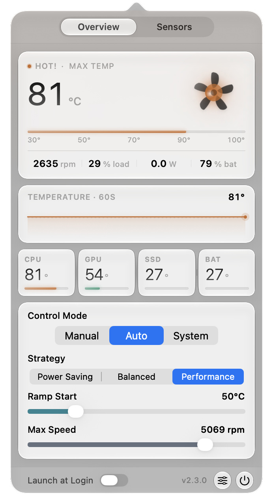
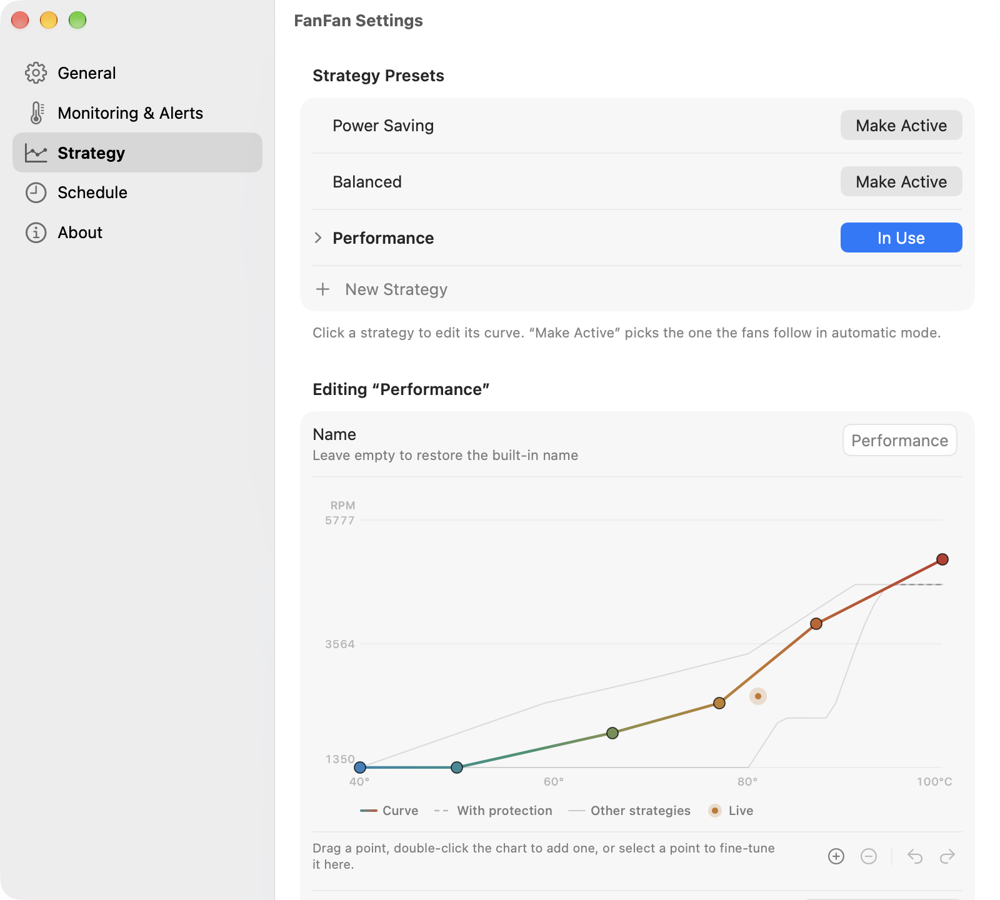

<div align="center">


# FanFan

A free, open-source Mac fan control and temperature monitor for the macOS menu bar.

[](https://github.com/hoobnn/fanfan/releases/latest)
[](https://github.com/hoobnn/fanfan/releases)
[](https://www.apple.com/macos/)
[](#homebrew)
[](LICENSE)

[简体中文](README.md) · **English**

</div>

FanFan is a free, open-source (MIT) Mac fan control and temperature monitoring app that lives in the macOS menu bar. It shows CPU, GPU, SSD and battery temperatures and fan speeds. You can pin the fans to a fixed speed, let FanFan adjust them along a temperature curve, or hand them back to macOS. It runs on Apple Silicon and Intel Macs with macOS 26 or later and installs with Homebrew.

<table>
  <tr>
    <td width="42%" align="center"></td>
    <td width="58%" align="center"></td>
  </tr>
  <tr>
    <td align="center"><sub>Menu bar popover</sub></td>
    <td align="center"><sub>Settings</sub></td>
  </tr>
</table>

## Features

- Fan RPM plus CPU, GPU, SSD and battery temperatures, depending on which sensors your Mac has. The popover shows the last 60 seconds as a chart, and the Sensors tab lists every reading.
- Three fan modes: a fixed RPM, automatic control based on temperature, or the Mac's own firmware control. On Macs with two fans you can set each one separately.
- Automatic mode follows each strategy's temperature-to-speed curve. Power Saving, Balanced and Performance are built in; in Settings › Strategy you can drag points to reshape a curve (its ends stay at 40°C and 100°C; only their speed changes), and create or rename strategies of your own. The popover adjusts the ramp-start temperature and maximum speed directly. Speed changes are smoothed (fast up, slow down) to avoid constant surging.
- Schedule: switch the fan mode and strategy at set times, every day, on weekdays or on weekends, for example a quieter strategy at night.
- The menu bar item can show temperature, power draw, fan speed as a percentage, or just the icon.
- A notification when the temperature passes a limit you set, with an option to switch to automatic mode at the same time. Above 85°C, thermal protection lets the fans exceed your maximum speed, up to a limit you can set.
- English, 简体中文, 繁體中文, 日本語, 한국어, Deutsch, Français and Español. FanFan follows the system language, or you can set its language on its own in System Settings › General › Language & Region › Applications.
- Built-in updates: FanFan checks for new versions in the background and offers to install them and relaunch. You can also check by hand, or turn automatic checks off, in Settings › About.
- Fan speeds are written by a separate privileged helper. If the app hangs for more than 10 seconds, quits or crashes, the fans go back to macOS control.

Fan controls are hidden on Macs without a fan. Which sensors you see and the available speed range depend on the model.

## Install

### Homebrew

```bash
brew tap hoobnn/tap
brew install --cask fanfan
```

### Manual

Download the latest DMG from [Releases](https://github.com/hoobnn/fanfan/releases/latest), or use the install script:

```bash
curl -fsSL https://raw.githubusercontent.com/hoobnn/fanfan/main/scripts/install.sh | bash
```

Requires macOS 26 or later (Apple Silicon or Intel). On first launch, click **Install Helper**, then allow FanFan in System Settings › General › Login Items & Extensions. No administrator password needed.

### Update

fanfan checks for updates on its own (via [Sparkle](https://sparkle-project.org); updates are verified with an EdDSA signature), or click **Check** in Settings › About. The helper switches to the new version by itself after an update, with no need to allow it again. If you installed with Homebrew, `brew upgrade --cask fanfan` works too.

### Uninstall

`brew uninstall --cask fanfan` removes the app and the helper; add `--zap` to remove preferences too. If you installed it manually, quit fanfan and delete it from Applications. The helper lives inside the app bundle and stops with it. If a fanfan entry is still listed under Login Items & Extensions, remove it there.

## FAQ

**Is FanFan free?**
Yes. It is open source under the [MIT](LICENSE) license, with no paid tier and no in-app purchases.

**Is it safe to change fan speed?**
FanFan never sets a speed above the maximum RPM the fan reports, and the helper rejects anything outside that range; below the start temperature it can stop the fans. If the app crashes, hangs or quits, the fans go back to macOS firmware control.

**Does it work on Apple Silicon (M-series) Macs? Which macOS versions?**
Yes. It's a universal app for Apple Silicon and Intel and requires macOS 26 or later; older systems can't install it. Fanless models such as the MacBook Air only show temperatures and hide fan controls.

**Why does it ask to run in the background?**
Writing fan speeds to the SMC needs root. So that the app itself doesn't run as root, FanFan registers a small root helper, and macOS asks you to allow it once in Login Items & Extensions. Reading temperatures needs no extra permission.

**Does FanFan collect any data?**
No. The app has no analytics or reporting code, and temperature and fan readings stay on your Mac. Its only network activity is Sparkle checking for updates, which you can turn off in Settings › About.

**How do I uninstall it?**
`brew uninstall --cask fanfan` (add `--zap` to remove preferences). If you installed it manually, quit FanFan, delete it from Applications, then remove any leftover entry under Login Items & Extensions. See Uninstall above.

**The fans don't respond, or I don't see fan controls. What should I check?**
First confirm your Mac has a fan (fanless MacBook Airs show no controls). If it does, open System Settings › General › Login Items & Extensions and make sure the FanFan helper is allowed. Sensors and speed ranges vary by model. If it still fails, open an [issue](https://github.com/hoobnn/fanfan/issues) with your Mac model and macOS version.

**How does it compare with Macs Fan Control or smcFanControl?**
It does the same core job: read SMC sensors and set fan speeds. FanFan is free and open source (MIT) and requires macOS 26 or later; its only third-party dependency is Sparkle, for in-app updates. If your Mac is on an older macOS, pick a tool that still supports it.

## How it works

The app runs as your normal user and reads temperatures directly through IOKit.

Writing fan speeds needs root, so that part is a small LaunchDaemon written in C (`fanfan-smcd`, registered with `SMAppService`). It holds the SMC handle and takes a few kinds of requests over a small versioned XPC protocol: health checks, lease renewal, fan targets, and handing control back to firmware. Only the FanFan app signed by its developer can connect. When the app quits or crashes, the fans go back to firmware right away; if the app hangs, the 10-second lease runs out and the same thing happens.

```text
fanfan.app  ──XPC──▶  fanfan-smcd (root)  ──IOKit──▶  SMC
```

## Build from source

Requires Xcode with the macOS 26 SDK.

```bash
make -C tools/fanfan-smcd                                   # build the helper
cp tools/fanfan-smcd/fanfan-smcd fanfan/Resources/fanfan-smcd
xcodebuild -project fanfan.xcodeproj -scheme fanfan -configuration Debug build
```

## Star history

<a href="https://star-history.com/#hoobnn/fanfan&Date">
  <picture>
    <source media="(prefers-color-scheme: dark)" srcset="https://api.star-history.com/svg?repos=hoobnn/fanfan&type=Date&theme=dark" />
    <source media="(prefers-color-scheme: light)" srcset="https://api.star-history.com/svg?repos=hoobnn/fanfan&type=Date" />
    
  </picture>
</a>

## Acknowledgements

FanFan started as a fork of [solofan](https://github.com/SoloTeamDev/solofan) (formerly ffan). Thanks to the solofan team.

## License

[MIT](LICENSE) © 2026 hoobnn. Free to use, modify and distribute, provided the copyright notice is kept.
